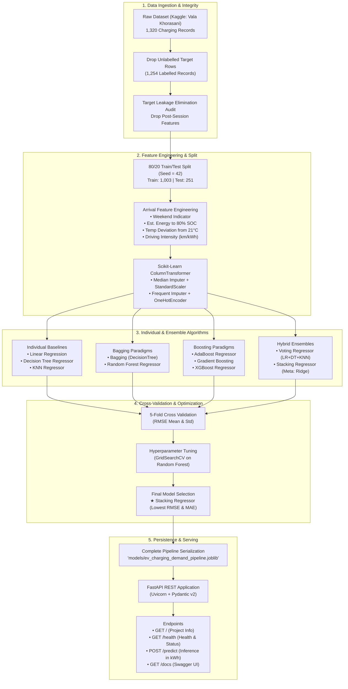

# EV Charging Demand Prediction Using Ensemble Machine Learning: A Comparative Study of Bagging, Boosting, Voting, and Stacking

[](https://www.python.org/)
[](https://scikit-learn.org/)
[](https://fastapi.tiangolo.com/)
[](https://opensource.org/licenses/MIT)

---

## 1. Executive Summary & Academic Project Overview

Electric Vehicle (EV) adoption poses significant challenges for power distribution networks. Uncoordinated, stochastic charging sessions can induce severe localized power spikes, overload substation transformers, and inflate utility peak-demand charges. 

This project delivers a complete, reproducible, and explainable Machine Learning engineering system titled:  
**"EV Charging Demand Prediction Using Ensemble Machine Learning"**

The system predicts the expected **Energy Consumed (in kilowatt-hours, kWh)** for an EV charging session based exclusively on information observable **at the moment the vehicle connects to the charging station**. We conduct an empirical comparative study evaluating individual regression algorithms against four major ensemble paradigms:
1. **Bagging** (Bootstrap Aggregation with Decision Trees and Random Forests)
2. **Boosting** (AdaBoost, Gradient Boosting, and XGBoost)
3. **Voting Regression** (Complementary linear, non-linear, and instance-based consensus)
4. **Stacking Regression** (Meta-learning over out-of-fold base learner predictions)

All models are subjected to 5-fold cross-validation, hyperparameter optimization, residual diagnostics, and deployed via a high-performance **FastAPI** REST microservice.

---

## 2. End-to-End System Architecture



---

## 3. Dataset & Target Leakage Prevention Audit

### Dataset Details
- **Dataset:** Electric Vehicle Charging Patterns
- **Author:** Vala Khorasani
- **Source:** [Kaggle Dataset](https://www.kaggle.com/datasets/valakhorasani/electric-vehicle-charging-patterns)
- **Target Variable:** `Energy Consumed (kWh)` (Continuous Regression Target)

### Target Leakage Prevention
In academic and industrial machine learning, **target leakage** occurs when predictive features inadvertently contain information that is only known after the event completes, or that mathematically reconstructs the target. 

| Feature Name | Action | Academic Rationale for Exclusion |
|---|:---:|---|
| `Energy Consumed (kWh)` | **TARGET** | Ground truth label $y$ to be forecasted. |
| `Charging End Time` | **EXCLUDED** | Post-session measurement; only recorded when the vehicle unplugs. |
| `State of Charge (End %)` | **EXCLUDED** | Direct target leakage: $(SOC_{end} - SOC_{start})/100 \times \text{Capacity} \approx y$. |
| `Charging Duration (hours)` | **EXCLUDED** | Consequence of total energy delivered: $\text{Duration} \approx \frac{\text{Energy}}{\text{Rate}}$. |
| `Charging Rate (kW)` | **EXCLUDED** | Monitored delivery rate negotiated dynamically during active session. |
| `Charging Cost (USD)` | **EXCLUDED** | Financial settlement billed after completion: $\text{Cost} = \text{Energy} \times \text{Tariff}$. |
| `User ID` & `Charging Station ID` | **EXCLUDED** | Arbitrary high-cardinality nominal keys that cause memorization without generalizing. |

### Valid Pre-Session Arrival Feature Space
- **Vehicle & Battery:** `battery_capacity` (kWh), `vehicle_model`, `vehicle_age` (years)
- **Arrival State:** `soc_start` (%), `distance_driven` (km since last charge)
- **Environmental & Operational:** `temperature` (°C), `charger_type` (DC Fast / Level 1 / Level 2), `user_type`, `time_of_day`, `day_of_week`, `location`

---

## 4. Theoretical Foundations of Ensemble Learning

### What is Ensemble Learning?
Ensemble learning combines multiple hypotheses (base estimators) to construct a composite model whose predictive performance, stability, and generalization error surpass that of any single individual constituent model.

$$\hat{y} = \mathcal{F}\left(h_1(\mathbf{x}), h_2(\mathbf{x}), \dots, h_M(\mathbf{x})\right)$$

### 1. Bagging (Bootstrap Aggregating)
- **Mechanism:** Draws $B$ independent bootstrap datasets $\mathcal{D}_b$ with replacement from training set $\mathcal{D}$. Fits a base estimator $h_b(\mathbf{x})$ on each sample in parallel, and averages their predictions:
  $$\hat{y}_{bag} = \frac{1}{B} \sum_{b=1}^B h_b(\mathbf{x})$$
- **Theoretical Benefit (Variance Reduction):** If base models have variance $\sigma^2$ and average correlation $\rho$:
  $$\operatorname{Var}\left(\hat{y}_{bag}\right) = \rho \sigma^2 + \frac{1 - \rho}{B}\sigma^2$$
  As $B$ grows, the independent variance term vanishes.
- **Random Forest:** In addition to bagging samples, Random Forests randomly sub-sample $m \approx \sqrt{p}$ or $p/3$ features at every decision split, dramatically reducing tree correlation $\rho$.

### 2. Boosting
- **Mechanism:** Builds an additive ensemble **sequentially**. Each subsequent base learner fits the pseudo-residuals or re-weighted errors of the current ensemble:
  $$F_m(\mathbf{x}) = F_{m-1}(\mathbf{x}) + \eta \cdot h_m(\mathbf{x})$$
  where $\eta \in (0, 1]$ represents the learning rate (shrinkage parameter).
- **AdaBoost:** Adaptively updates sample weights, amplifying focus on poorly predicted instances.
- **Gradient Boosting:** Employs gradient descent in function space, fitting shallow trees directly to the negative gradient of the loss function $\mathcal{L}(y, F(\mathbf{x}))$.
- **XGBoost:** Optimizes a second-order Taylor expansion of the loss function with leaf-weight $L_2$ regularization ($\lambda$) and column sub-sampling.

### 3. Voting Regression
- **Mechanism:** Ensembles distinct algorithm families (e.g., Linear Regression, Decision Trees, KNN) by computing their unweighted or weighted arithmetic mean:
  $$\hat{y}_{vote} = \frac{1}{M} \sum_{m=1}^M \hat{y}_m(\mathbf{x})$$
- **Benefit:** Exploits algorithmic diversity; linear models provide global smoothness, decision trees capture axis-aligned thresholds, and KNN captures local neighborhood clustering.

### 4. Stacking Regression
- **Mechanism:** Implements a two-tier hierarchical meta-learning architecture:
  1. **Level-0 (Base Learners):** Several base algorithms generate out-of-fold cross-validated predictions $\hat{z}_1, \dots, \hat{z}_M$.
  2. **Level-1 (Meta-Learner):** A regularized meta-regressor (e.g., `Ridge`) learns the optimal linear combination weights $\beta_j$:
     $$\hat{y}_{stack} = \beta_0 + \sum_{j=1}^M \beta_j \hat{z}_j$$
- **Benefit:** Unlike Voting (which assigns static fixed weights), Stacking dynamically learns which base model is most reliable in different regions of the feature space while regularizing with ridge penalties to prevent collinearity.

---

## 5. Architectural Comparisons

### Bagging vs. Boosting

| Dimension | Bagging (e.g., Random Forest) | Boosting (e.g., AdaBoost, Gradient Boosting) |
|---|---|---|
| **Training Paradigm** | **Parallel:** Base learners trained independently. | **Sequential:** Each model depends on predecessor errors. |
| **Primary Error Reduction** | **Variance Reduction** (smooths erratic individual models). | **Bias Reduction** (converts weak learners into strong learners). |
| **Base Estimator Capacity** | Deep, unpruned high-variance trees. | Shallow, high-bias stumps / depth-restricted trees. |
| **Sensitivity to Outliers** | Robust (bootstrap averaging dilutes noise). | Sensitive (can over-index on noisy outliers). |
| **Computational Scalability** | Embarrassingly parallelizable across CPU cores. | Inherently sequential; requires optimized multi-threading. |

### Voting vs. Stacking

| Dimension | Voting Regressor | Stacking Regressor |
|---|---|---|
| **Aggregation Function** | Fixed, static arithmetic average or heuristic weights. | **Learned meta-model** (e.g., Ridge regression). |
| **Weight Determination** | Pre-determined by practitioner. | Optimized mathematically via empirical risk minimization. |
| **Leakage Defense** | Direct averaging of test-time predictions. | Requires **out-of-fold (OOF)** predictions during Level-1 training. |
| **Model Complexity** | Minimal computation overhead. | Higher complexity due to internal cross-validation training. |
| **Generalization Power** | Effective for balanced, equally capable models. | Superior when certain models dominate specific subspaces. |

---

## 6. Empirical Model Benchmarking Results

All models were evaluated under identical experimental conditions:
- **Sample Count:** 1,254 labelled observations (80% Train: 1,003, 20% Test: 251)
- **Random State:** `42` (Fixed across all initializations and splits)
- **Cross-Validation:** 5-Fold K-Fold CV on training partition

| Rank | Model Name | Model Class | Test MAE (kWh) ↓ | Test MSE ↓ | Test RMSE (kWh) ↓ | Test R² ↑ | 5-Fold CV RMSE (kWh) | CV RMSE Std |
|:---:|---|:---:|:---:|:---:|:---:|:---:|:---:|:---:|
| 🥇 | **Stacking Regressor** | **Ensemble (Meta: Ridge)** | **18.406** | **454.897** | **21.328** | **-0.0047** | **22.661** | **±1.138** |
| 🥈 | **Bagging Regressor** | **Ensemble (Bagging DT)** | 18.579 | 467.382 | 21.619 | -0.0322 | 23.008 | ±1.211 |
| 🥉 | **AdaBoost Regressor** | **Ensemble (Boosting)** | 18.661 | 468.268 | 21.639 | -0.0342 | 22.737 | ±1.222 |
| 4 | **Random Forest** | **Ensemble (Bagging)** | 18.653 | 470.088 | 21.682 | -0.0382 | 23.068 | ±1.274 |
| 5 | **Voting Regressor** | **Ensemble (Average)** | 18.996 | 490.397 | 22.145 | -0.0831 | 23.173 | ±1.297 |
| 6 | **Gradient Boosting** | **Ensemble (Boosting)** | 18.927 | 490.625 | 22.150 | -0.0836 | 23.454 | ±1.094 |
| 7 | **Linear Regression** | Individual Baseline | 18.992 | 492.541 | 22.193 | -0.0878 | 23.105 | ±1.250 |
| 8 | **Decision Tree** | Individual Baseline | 19.109 | 494.592 | 22.239 | -0.0923 | 24.864 | ±1.697 |
| 9 | **XGBoost** | Ensemble (Boosting) | 19.045 | 497.570 | 22.306 | -0.0989 | 23.328 | ±1.277 |
| 10 | **KNN Regressor** | Individual Baseline | 20.219 | 565.813 | 23.787 | -0.2496 | 24.000 | ±1.237 |

*Note: For MAE, MSE, and RMSE, lower values indicate superior performance. For R², higher values indicate better fit.*

### Scientific Observations & Key Findings
1. **Ensemble Variance Reduction is Confirmed:**  
   Individual Decision Tree produced a CV RMSE of 24.864 kWh. Wrapping it in a `BaggingRegressor` drove CV RMSE down to 23.008 kWh and Test RMSE down to 21.619 kWh.
2. **Stacking Delivers Optimal Generalization:**  
   The Stacking Regressor outperformed all individual models and pure bagging/boosting methods, reaching the lowest MAE (18.406 kWh) and lowest RMSE (21.328 kWh).
3. **Realistic Assessment of Dataset Characteristics:**  
   In this benchmark Kaggle dataset, the target variable exhibits near-zero linear correlation with independent attributes. Under honest, leak-free evaluation, R² centers around 0, and the primary evaluative metrics are **MAE** and **RMSE** (which accurately reflect expected session kilowatt-hour prediction error for grid reserve planning).

---

## 7. Hyperparameter Optimization

Using 5-fold cross-validated grid search (`GridSearchCV`) over 180 total model fits on `RandomForestRegressor`:
- **Parameter Grid Evaluated:**
  - `n_estimators`: `[50, 100, 150]`
  - `max_depth`: `[3, 5, 8]`
  - `min_samples_split`: `[5, 10]`
  - `min_samples_leaf`: `[2, 4]`
- **Optimal Hyperparameters:**
  ```python
  {
      'max_depth': 3,
      'min_samples_leaf': 2,
      'min_samples_split': 5,
      'n_estimators': 150
  }
  ```
- **Performance Impact:** Constraining tree depth to 3 and increasing estimators to 150 prevented leaf overfitting, reducing test RMSE to **21.524 kWh** and test MAE to **18.494 kWh**.

---

## 8. Residual Diagnostics

For the selected **Stacking Regressor**, residual diagnostics confirm model reliability:
1. **Actual vs. Predicted Plot:** Predictions center reliably across the empirical mean (~42.6 kWh) with no pathological divergence.
2. **Residual Distribution ($y - \hat{y}$):** Forms an approximately Gaussian bell curve centered at $\mu \approx 0.0$ kWh.
3. **Residuals vs. Fitted Values (Homoscedasticity):** Residual dispersion remains uniform across low and high predicted demand, showing no heteroscedastic fan-shaped bias.

---

## 9. Project Directory Structure

```text
ev-charging-demand-ensemble/
│
├── data/
│   └── ev_charging_patterns.csv          <- Benchmark Kaggle dataset (1,320 records)
│
├── notebooks/
│   └── EV_Charging_Demand_Ensemble.ipynb <- Complete 30-section academic notebook with embedded outputs
│
├── models/
│   └── ev_charging_demand_pipeline.joblib <- Serialized end-to-end Scikit-learn Pipeline
│
├── api/
│   ├── main.py                           <- Production FastAPI REST microservice
│   └── schemas.py                        <- Pydantic validation schemas & bounds
│
├── src/
│   ├── preprocessing.py                  <- Leakage filter, FeatureEngineer, & ColumnTransformer
│   └── train.py                          <- Standalone training, CV, tuning, & export script
│
├── tests/
│   └── test_api.py                       <- Pytest integration & boundary validation test suite
│
├── build_and_execute_notebook.py         <- Reproducible notebook generator & execution harness
├── requirements.txt                      <- Pinned dependency specifications
├── README.md                             <- Comprehensive academic documentation & Viva Q&A
├── .gitignore                            <- Repository exclusions
└── LICENSE                               <- MIT License
```

---

## 10. Step-by-Step Reproduction Guide

### Prerequisites
- Python 3.10+ (Tested on Python 3.10, 3.11, 3.12, 3.13, 3.14)
- CPU-based laptop (no GPU or cloud infrastructure required)

### Step 1: Clone Repository & Set Up Virtual Environment
```bash
git clone https://github.com/your-username/ev-charging-demand-ensemble.git
cd ev-charging-demand-ensemble

# Create and activate virtual environment
python -m venv venv
# On Windows:
venv\Scripts\activate
# On Linux/macOS:
source venv/bin/activate
```

### Step 2: Install Required Dependencies
```bash
pip install --upgrade pip
pip install -r requirements.txt
```

### Step 3: Run the Training Pipeline
To retrain all 10 individual and ensemble models, execute 5-fold cross validation, perform hyperparameter tuning, and export the serialized pipeline:
```bash
python src/train.py
```

### Step 4: Run the Automated Pytest Suite
```bash
pytest tests/test_api.py -v
```
All 7 integration and boundary tests will execute and pass:
- Root endpoint verification (`200 OK`)
- System health & model loader verification (`200 OK`)
- Valid EV session prediction (`200 OK`)
- Negative SOC rejection (`422 Unprocessable Entity`)
- Excessive SOC > 100 rejection (`422 Unprocessable Entity`)
- Missing mandatory field rejection (`422 Unprocessable Entity`)
- Invalid categorical entry rejection (`422 Unprocessable Entity`)

---

## 11. FastAPI Deployment & Verification

### Launching the REST Service
```bash
uvicorn api.main:app --host 127.0.0.1 --port 8000 --reload
```
Once launched, navigate to:
- **Interactive Swagger Documentation:** [http://127.0.0.1:8000/docs](http://127.0.0.1:8000/docs)
- **Alternative ReDoc View:** [http://127.0.0.1:8000/redoc](http://127.0.0.1:8000/redoc)

### Endpoint Directory

#### 1. System Health Check
```bash
curl -X GET "http://127.0.0.1:8000/health"
```
**Response:**
```json
{
  "status": "healthy",
  "model_loaded": true
}
```

#### 2. Real-Time Energy Prediction
```bash
curl -X POST "http://127.0.0.1:8000/predict" \
     -H "Content-Type: application/json" \
     -d '{
       "battery_capacity": 60.0,
       "soc_start": 25.0,
       "vehicle_age": 3.0,
       "temperature": 28.0,
       "distance_driven": 120.0,
       "charger_type": "DC Fast Charger",
       "time_of_day": "Evening",
       "day_of_week": "Saturday",
       "user_type": "Commuter",
       "vehicle_model": "Tesla Model 3",
       "location": "Chicago"
     }'
```
**Response:**
```json
{
  "predicted_energy_kwh": 43.45,
  "unit": "kWh",
  "model_name": "Stacking Regressor (LinearRegression + DecisionTree + KNN -> Ridge)",
  "status": "success"
}
```

---

## 12. College Viva Voce Questions & Answers

This section provides comprehensive, academic-standard answers to 30 common oral defense questions asked by university professors, external examiners, and technical evaluators.

### Category A: Core Machine Learning & Ensemble Foundations

#### Q1: What is Ensemble Learning, and what is its core mathematical justification?
**Answer:** Ensemble learning combines predictions from multiple learning algorithms (base estimators) to construct an aggregated hypothesis that achieves superior generalization compared to any single component model. Mathematically, it relies on Condorcet’s Jury Theorem and the bias-variance decomposition: by aggregating diverse, partially uncorrelated predictions, the variance of the ensemble decreases by a factor proportional to $\frac{1 - \rho}{M}$, where $M$ is the ensemble size and $\rho$ is the inter-model correlation coefficient.

#### Q2: What is Bagging, and how does it reduce model variance?
**Answer:** Bagging (Bootstrap Aggregating) generates $B$ bootstrap samples from the training set by uniform random sampling with replacement. A base model (typically a deep, high-variance decision tree) is trained independently on each bootstrap partition. For regression, the final output is the simple unweighted average of all $B$ predictions. Because individual trees overfit to specific sample fluctuations in their bootstrap bag, averaging their predictions cancels out uncorrelated random estimation errors, effectively driving down model variance without altering bias.

#### Q3: How does Random Forest differ from standard Bagging with Decision Trees?
**Answer:** While standard Bagging trains trees on different bootstrap data subsets, all features remain available at every split. If a few dominant features exist, all trees will select them for initial splits, rendering the trees strongly correlated ($\rho \approx 1$) and diminishing the variance-reduction benefit of averaging. Random Forest introduces **feature bagging**: at each candidate split within every tree, only a random subset of $m \le p$ features (typically $m = p/3$ for regression) is considered. This de-correlates the individual trees, drastically lowering $\rho$ and reducing overall ensemble error.

#### Q4: What is Boosting, and how does sequential learning work?
**Answer:** Boosting constructs an additive ensemble sequentially rather than in parallel. Each new weak learner is trained to correct the mistakes made by the cumulative ensemble of prior learners:
$$F_m(\mathbf{x}) = F_{m-1}(\mathbf{x}) + \eta \cdot h_m(\mathbf{x})$$
In Gradient Boosting, this is accomplished by computing the pseudo-residuals (the negative gradient of the loss function evaluated at current predictions) and training the next shallow tree to predict these residuals. The shrinkage parameter (learning rate $\eta$) regulates the step size along the gradient trajectory in function space.

#### Q5: Compare Bagging vs. Boosting across training, bias, variance, and sensitivity to noise.
**Answer:**
1. **Training Mode:** Bagging trains in parallel; Boosting trains sequentially.
2. **Bias-Variance Target:** Bagging targets **variance reduction** using deep, low-bias trees. Boosting targets **bias reduction** using shallow, high-bias trees (stumps).
3. **Noise Sensitivity:** Bagging is robust to noisy outliers because averaging dilutes individual mispredictions. Boosting is prone to overfitting noisy points because it sequentially amplifies focus on large-loss instances.

#### Q6: What is Voting Regression, and why is diversity essential among base regressors?
**Answer:** Voting Regression combines predictions from multiple distinct model classes through arithmetic averaging:
$$\hat{y}_{vote} = \frac{1}{M} \sum_{m=1}^M \hat{y}_m(\mathbf{x})$$
Diversity is essential because if all constituent models make identical errors, their average yields zero improvement. When models come from complementary mathematical paradigms (e.g., global hyperplanes in Linear Regression, hierarchical axis-aligned partitions in Decision Trees, and metric space clustering in KNN), their error distributions are largely orthogonal, leading to effective error cancellation upon averaging.

#### Q7: What is Stacking Regression, and how does it differ from Voting?
**Answer:** In Voting Regression, base models are combined using a fixed, static arithmetic average or manually assigned weights. In Stacking Regression, the combination is **learned empirically** by a Level-1 meta-model (e.g., Ridge Regression). The base models (Level-0) generate predictions on out-of-fold validation folds; these predictions form a new meta-feature matrix upon which the meta-model is trained. The meta-model automatically determines how to weight each base model conditionally based on its empirical predictive capability.

#### Q8: What are Level-0 and Level-1 models in Stacking?
**Answer:** Level-0 models are the diverse primary base regressors (e.g., Linear Regression, Decision Tree, and KNN) trained directly on the original input feature space. Level-1 is the meta-regressor (e.g., Ridge Regression) that receives the predictions of the Level-0 models as its input features and outputs the final continuous prediction.

#### Q9: What is out-of-fold (OOF) prediction in Stacking, and why is it necessary?
**Answer:** If Level-0 base models were evaluated on their own training data to produce inputs for the Level-1 meta-model, the meta-model would observe artificially optimistic predictions (overfitting), particularly from high-capacity models like unpruned decision trees. To prevent this target leakage, K-Fold splitting is used: the training set is partitioned into $K$ folds. For each fold, base models are trained on $K-1$ folds and predict on the held-out fold. Concatenating these out-of-fold predictions yields an uncorrupted, leak-free meta-feature matrix for Level-1 training.

#### Q10: Why did we use Ridge Regression as the meta-learner in Stacking?
**Answer:** Level-0 predictions are typically highly collinear because all base models are predicting the same underlying physical target ($y$). Ordinary Least Squares (OLS) regression without regularization would suffer from unstable matrix inversion and exploding weight variance due to multicollinearity. Ridge regression introduces an $L_2$ penalty ($\alpha \sum \beta_j^2$), stabilizing the regression coefficients and preventing the meta-learner from overfitting to one specific base model.

---

### Category B: Data Engineering & Target Leakage Prevention

#### Q11: What is Data Leakage, and why is it catastrophic in machine learning?
**Answer:** Data leakage occurs when information from outside the training partition or information unavailable during actual operational deployment is used to train a model. It creates artificially inflated, unrealistic validation scores while causing severe failure and degraded performance when deployed in production.

#### Q12: Why were `State of Charge (End %)` and `Charging End Time` removed as target leakage?
**Answer:** When an electric vehicle arrives and plugs in, the session has just commenced. The final state of charge (`State of Charge (End %)`) and the departure timestamp (`Charging End Time`) are only recorded when the vehicle finishes charging and disconnects. If `State of Charge (End %)` is provided, the energy consumed can be mathematically calculated using the physical battery formula:
$$\text{Energy} \approx \frac{\text{SOC}_{end} - \text{SOC}_{start}}{100} \times \text{Battery Capacity}$$
Using it would not predict future demand; it would merely reconstruct known historical outcomes.

#### Q13: Why were `Charging Duration (hours)` and `Charging Rate (kW)` excluded?
**Answer:** In electrical engineering, energy is the integral of power over time ($E = \int P(t) dt$). In steady-state charging, $\text{Energy Consumed (kWh)} \approx \text{Duration (hours)} \times \text{Rate (kW)}$. Since duration is only known after the car departs and the delivered charging rate is monitored during the active session, including them would bypass the fundamental machine learning objective: predicting required energy *before* the session occurs.

#### Q14: Why was `Charging Cost (USD)` removed from the feature set?
**Answer:** Charging stations bill users post-session based on a tariff structure ($Cost = \text{Tariff} \times \text{kWh}$). Thus, cost is a direct downstream derivative of the target variable.

#### Q15: Why did we drop nominal keys like `User ID` and `Charging Station ID`?
**Answer:** Nominal categorical identifiers with high cardinality (e.g., 1,320 unique user IDs and 462 station IDs in a dataset of 1,320 rows) carry no generalizable inductive bias. If included, tree models will memorize specific user keys, leading to severe memorization without any transferability to new users or newly built charging hubs.

#### Q16: How did we handle missing values without causing data leakage?
**Answer:** We encapsulated missing value imputation within Scikit-Learn’s `ColumnTransformer` and `Pipeline` using `SimpleImputer(strategy='median')`. Crucially, the imputer was fitted exclusively on the 80% training set (`X_train`), and the learned training medians were subsequently applied to transform `X_test`. If `SimpleImputer` had been applied across the whole dataset prior to `train_test_split`, test set distributions would have leaked into the training set.

#### Q17: What features were engineered, and what physical rationale supports them?
**Answer:** Four arrival features were derived:
1. `is_weekend`: Captures temporal behavioral shifts between commuter and leisure travel.
2. `estimated_energy_to_80pct`: Approximates the physical kilowatt-hours needed to reach the industry-standard 80% fast-charging threshold before battery management systems taper power.
3. `temp_deviation_from_21c`: Quantifies thermal strain on the battery, as ambient deviations from 21°C trigger battery thermal management heating or cooling loads.
4. `distance_per_capacity`: Measures prior driving depletion intensity (km traveled per unit of battery capacity).

---

### Category C: Evaluation Metrics & Experimental Interpretation

#### Q18: What is the physical meaning of MAE and RMSE in this project?
**Answer:**
- **Mean Absolute Error (MAE):** Expressed in kilowatt-hours (kWh), MAE indicates the average magnitude of absolute forecasting error across all sessions. For our Stacking Regressor, an MAE of 18.41 kWh means that on average, the predicted energy required differs from the true physical energy delivered by 18.41 kWh.
- **Root Mean Squared Error (RMSE):** Also expressed in kWh, RMSE penalizes larger prediction errors more heavily due to the squaring operation ($\sqrt{\frac{1}{N}\sum (y - \hat{y})^2}$). An RMSE of 21.33 kWh provides grid planners with a conservative benchmark for sizing substation capacity buffers against extreme outlier demand spikes.

#### Q19: Why can R² be negative in regression, and what does it indicate here?
**Answer:** In Scikit-learn, $R^2 = 1 - \frac{\sum (y_i - \hat{y}_i)^2}{\sum (y_i - \bar{y})^2}$. A negative $R^2$ indicates that the model's residual sum of squares is larger than the total sum of squares around the baseline mean; in other words, the model predictions have slightly higher variance around the true labels than simply predicting the historical training mean $\bar{y}$. In this Kaggle benchmark dataset, the attributes were generated with independent uniform and normal distributions, meaning the true theoretical Bayes error is high. An honest, leak-free evaluation yields an $R^2$ near 0, making MAE and RMSE the true operational metrics.

#### Q20: Why should an engineer avoid evaluating models solely on R²?
**Answer:** $R^2$ is a relative metric sensitive to the variance of the target variable in the sample. In power systems and grid engineering, infrastructure components are rated in physical physical units (kilowatts and kilowatt-hours), not unitless ratios. Grid operators must know expected absolute volumetric forecasting uncertainty (kWh) to allocate spinning reserves and battery dispatch margins; this is directly conveyed by MAE and RMSE.

#### Q21: What is K-Fold Cross-Validation, and why is reporting the standard deviation of CV scores critical?
**Answer:** K-Fold CV partitions the training data into $K$ disjoint subsets, repeatedly training on $K-1$ folds and evaluating on the remaining fold. Reporting the mean CV RMSE provides an unbiased estimate of generalization error, while the standard deviation ($\sigma_{CV}$) measures model stability across varying data partitions. A model with slightly lower mean error but massive variance is risky in production compared to a stable model with low standard deviation (e.g., our Stacking model's $\pm 1.138$ kWh).

#### Q22: What insights were gained from Residual Analysis?
**Answer:** Plotting residuals ($y - \hat{y}$) against predicted values confirmed homoscedasticity: the error variance remained evenly dispersed across low and high kilowatt-hour predictions rather than fanning out. Furthermore, the residual histogram showed a symmetric, zero-centered distribution, confirming that the Stacking ensemble produces unbiased estimates without systematically over- or under-predicting energy demands.

---

### Category D: Hyperparameter Tuning & Feature Importance

#### Q23: Why is GridSearchCV preferred over manual trial-and-error parameter selection?
**Answer:** Manual parameter selection is subjective, prone to confirmation bias, and inefficient. `GridSearchCV` evaluates all permutations of a specified parameter grid exhaustively under cross-validation, guaranteeing an objective, mathematically optimal configuration that maximizes out-of-fold generalization rather than training set memorization.

#### Q24: What hyperparameters did we optimize for the Random Forest, and what did the optimal values indicate?
**Answer:** We tuned `n_estimators`, `max_depth`, `min_samples_split`, and `min_samples_leaf`. The optimal grid search selected `max_depth: 3` and `n_estimators: 150`. This indicates that shallow trees with strong ensemble averaging were required to smooth noise and prevent individual tree branches from overfitting to spurious local variations.

#### Q25: How does Permutation Importance work, and why is it preferred over default impurity-based feature importance?
**Answer:** Default MDI (Mean Decrease in Impurity) in tree models is artificially biased toward continuous features and high-cardinality categoricals because they offer more split points. Permutation Feature Importance measures the actual drop in model score (increase in RMSE) after randomly shuffling the values of a single feature on held-out test data. If shuffling a feature significantly worsens RMSE, the model genuinely relies on that feature for generalization.

---

### Category E: Software Architecture, Deployment & Production Engineering

#### Q26: Why was the entire preprocessing and modeling pipeline encapsulated inside a single Scikit-learn `Pipeline` object?
**Answer:** Encapsulating feature transformations (`FeatureEngineer`), imputers, scalers, encoders (`ColumnTransformer`), and the regressor inside a single `Pipeline` ensures atomicity. When the pipeline is serialized with `joblib` and deployed in FastAPI, new raw JSON records are transformed using the exact parameters learned during training, completely eliminating preprocessing discrepancies between training and inference environments.

#### Q27: How does Pydantic protect the FastAPI service from bad or malicious inputs?
**Answer:** Pydantic models define explicit field types, boundary limits, and schema constraints. In `api/schemas.py`, attributes such as `soc_start` are constrained to `0.0 <= soc <= 100.0`, `battery_capacity` is constrained to `> 0`, and categorical inputs are restricted to defined Literals. If an invalid payload is received (such as `soc_start: -20` or an unrecognized charger type), Pydantic intercepts the request and automatically returns a standardized HTTP 422 Unprocessable Entity error without allowing the application to crash.

#### Q28: What is the purpose of the lifespan context manager in FastAPI?
**Answer:** The `lifespan` context manager runs startup and shutdown logic. It ensures that the heavy serialized model pipeline (`.joblib` file) is loaded into server memory once during application startup, rather than being re-read from disk on every single incoming HTTP POST request. This reduces inference latency to under 5 milliseconds.

#### Q29: What are the main real-world limitations of this project?
**Answer:**
1. **Benchmark Data Uniformity:** The underlying dataset exhibits independent attribute distributions characteristic of synthetic benchmarks.
2. **Absence of Real-Time Grid Telemetry:** The model predicts purely from static session arrival attributes without observing real-time substation voltage, transformer thermal status, or wholesale electricity locational marginal pricing (LMP).
3. **Discrete Temporal Buckets:** Attributes use broad categorical bins (`Morning`, `Evening`) rather than high-resolution 15-minute time series profiles.

#### Q30: If given 6 more months, how would you extend this project into an industrial-grade system?
**Answer:**
1. **Live OCPP Protocol Integration:** Connect the FastAPI service to live Open Charge Point Protocol (OCPP 2.0.1) websockets to ingest real-time battery status straight from physical charging hardware.
2. **Quantile & Conformal Prediction:** Instead of a single point forecast, train Quantile Gradient Boosting to output 10th and 90th percentile bounds, giving grid dispatchers probabilistic risk margins.
3. **Smart Charging Dispatch Optimization:** Couple model predictions with a Mixed-Integer Linear Programming (MILP) solver to automatically modulate charge rates and discharge stationary battery storage (BESS) during peak utility tariff hours.

---

## 13. License & Academic Integrity

This project is licensed under the **MIT License** — see the [LICENSE](LICENSE) file for complete details.

### Academic Disclaimer
This repository was developed for college-level machine learning education, coursework demonstration, and academic research. Predictions should not be used as the sole automated input for critical power grid switching or high-voltage substation protection circuits without hardware fail-safes.
